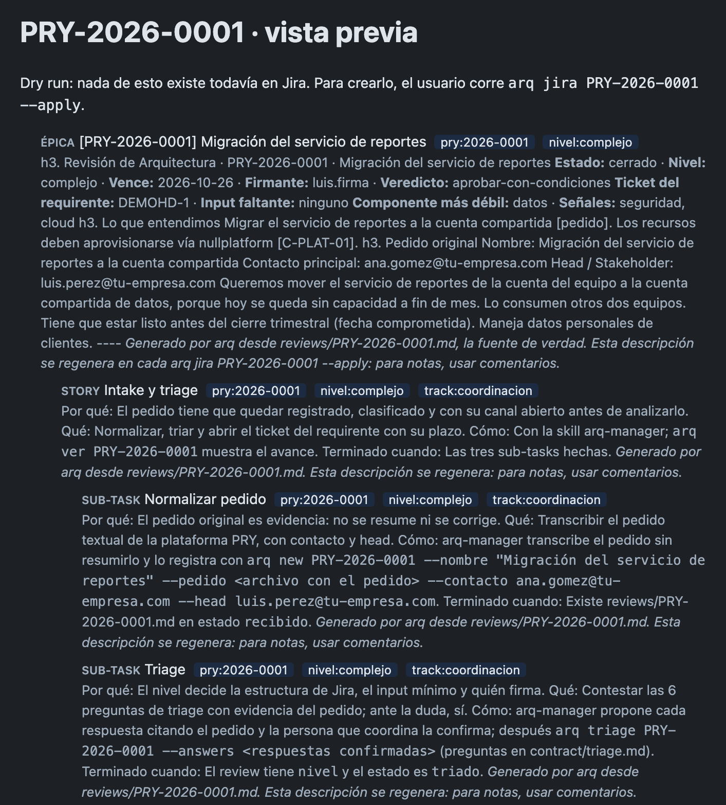

# arq-review

Dos skills para Claude Code, Codex y Cursor, y un CLI (`arq`), para llevar la revisión de Arquitectura de los pedidos
`PRY-AAAA-NNNN` de punta a punta: desde que llega el pedido hasta la devolución firmada. Cada una responde a algo
distinto que le pedís al agente:

| Le decís al agente… | Y la skill… |
|---|---|
| *«Registrá el PRY-2026-0001»*, *«hacé el triage»* | `arq-manager` copia el pedido tal cual, te propone las respuestas citando el pedido y deja el nivel (`simple` o `complejo`) cuando las confirmás vos |
| *«Armá el Jira del PRY-2026-0001»* | `arq-manager` te muestra la épica, las historias y las sub-tasks, y te pasa el comando que las crea junto con el ticket del requirente; lo corrés vos |
| *«¿Cómo viene el PRY-2026-0001?»* | `arq-manager` te da el comando de solo lectura que muestra el árbol de la épica con el avance de cada tarea |
| *«Hacé el gap check»*, *«analizá el pedido»* | `arq-architect` revisa el input mínimo, analiza contra las constraints, propone el original más dos opciones para lo más débil, señales para Cloud, Seguridad y FinOps, y un veredicto propuesto |
| *«Publicá el pedido de información»*, *«publicá la devolución»* | `arq-manager` muestra el mensaje exacto, controla que siga la plantilla y te pasa el comando para publicarlo |
| *«Firmo como…»*, *«cerrá el pedido»* | `arq-manager` registra la firma, crea las sub-tasks de las condiciones y cierra con el resultado que corresponde al veredicto |

**Nada se escribe en Jira sin `--apply`, y el `--apply` lo corrés vos, no el agente.** Tampoco aprueba ni rechaza en la
plataforma PRY: ese click es de una persona. No hay ventana de aprobación como en otras herramientas del Harness: el
control es el dry run que ves antes y el comando que corrés vos. Los [límites](docs/referencia.md#garantías) están en la
referencia.

## Elegí por dónde empezar

| Skill | Qué resuelve | Jira | Se instala con | Showcase | Instalación |
|---|---|---|---|---|---|
| **`arq-manager`** | Registrar, clasificar, abrir la épica y el ticket del requirente, cuidar el plazo, publicar y cerrar | Escribe, con `--apply` que corrés vos (y `arq ver`, solo lectura) | `./install.sh` | [Ver el caso](docs/showcase.md#2-armar-el-jira-del-pedido) | [Instalar](docs/instalacion.md#1-instalar) |
| **`arq-architect`** | Revisar el input mínimo, analizar contra las constraints, opciones y veredicto propuesto | No escribe en Jira; deja todo en `reviews/PRY-AAAA-NNNN.md` | `./install.sh` | [Ver el caso](docs/showcase.md#4-gap-check-y-pedido-de-información) | [Instalar](docs/instalacion.md#1-instalar) |
| **`arq`** (CLI) | Estado del review, guardas, dry run y escritura en Jira; lo usan las dos skills | Escribe solo con `--apply` | `./install.sh` | [Ver el caso](docs/showcase.md#9-las-guardas-del-cli) | [Instalar](docs/instalacion.md#1-instalar) |

Las dos skills se instalan juntas y nunca se llaman entre sí: cada una mira el estado del review y sabe si le toca. Por
eso hay **un solo juego de documentos** para todo el repo.

## Un ejemplo: armar el Jira de un pedido

El agente te muestra, sin escribir nada, la épica con sus historias y sub-tasks (en consola y en una página
`vista.html`) y el comando para crearlas. Lo corrés vos y recién ahí se escribe. El recorrido completo está en el
[showcase](docs/showcase.md#2-armar-el-jira-del-pedido).



*Recorte de la página `vista.html` real que genera `arq jira --html`, con un pedido de ejemplo.*

## Qué documento leer

| Si querés… | Leé | Qué encontrás |
|---|---|---|
| **Instalarlo y probarlo, desde Cursor** | [Instalación y primer uso](docs/instalacion.md) | Todo con prompts: instalar, preparar el repo de reviews, credenciales, registrar un pedido y llevarlo hasta el cierre, con maquetas de Cursor |
| **Instalarlo comando por comando** | [Instalación detallada](docs/instalacion-detallada.md) | Requisitos, `./install.sh`, el repo de reviews, credenciales, y el recorrido de un pedido corriendo cada comando de `arq`, con capturas de la terminal |
| **Ver todo lo que hace** | [Showcase](docs/showcase.md) | Cada etapa en un escenario: qué le decís al agente, qué comandos corre, qué ves y qué te protege |
| **Consultar un comando o una regla** | [Referencia](docs/referencia.md) | El README original: todos los comandos, el repo de reviews y su `config.json`, las garantías, las guías y presentaciones |

## En tres comandos

```bash
git clone git@github.com:josefigueredo/arch-review.git arq-review
cd arq-review && ./install.sh     # enlaza las dos skills y deja `arq` en ~/.local/bin
arq --help                        # comprueba que el comando responde, sin tocar nada
```

Después, `arq` se usa parado en el repo de reviews de tu equipo (no en este), y las escrituras en Jira necesitan
[tus credenciales](docs/instalacion-detallada.md#3-credenciales-de-jira) (tres variables de entorno). Requisitos:
`python3` 3.9 o más (solo biblioteca estándar) y acceso al repo.

## Desarrollo

```bash
python3 -m unittest discover -s tests -v          # con Jira falso: nunca sale a la red
/usr/bin/python3 -m unittest discover -s tests    # compatibilidad 3.9
```

Las reglas para quien modifica este repo están en [`AGENTS.md`](AGENTS.md); el diseño y sus decisiones (D1–D16), en la
[referencia](docs/referencia.md).
