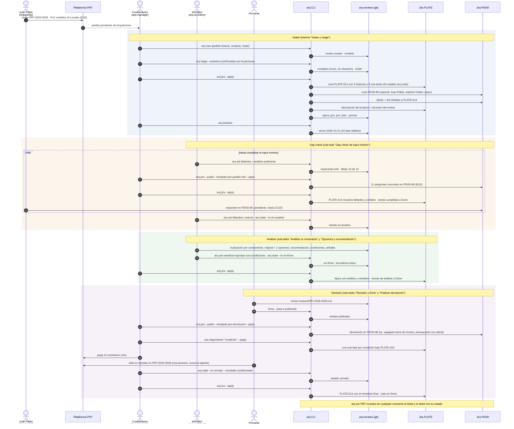

# Jira: boards, orden de ejecución y secuencia

Ejemplo real: **PRY-2026-0028 · PoC modelos IA Locales** (nivel `complejo`), estado al 2026-10-08. Pide Juan Pablo
Fernández; su head es Felipe López. La versión para público no técnico está en `docs/presentacion/revision-arquitectura.html`.

Hay una imagen de cada diagrama al lado de este archivo, para pegar donde no se renderiza Mermaid (Confluence,
presentaciones): `jira-flujo-boards.png` y `jira-flujo-secuencia.png`. Si cambia un diagrama, se regeneran con:

```bash
mmdc -i docs/diagrams/jira-flujo.md -o /tmp/jira-flujo.png -b white -w 2200 -s 2 \
  && cp /tmp/jira-flujo-1.png docs/diagrams/jira-flujo-boards.png \
  && cp /tmp/jira-flujo-2.png docs/diagrams/jira-flujo-secuencia.png
```

## 1. Boards PLATE y PEHD: issues, jerarquía y orden de ejecución

- Cada issue: **número de orden de ejecución · clave de Jira · nombre**.
- El anidamiento muestra la jerarquía de Jira: épica → historia → sub-task.
- Las flechas sólidas son la **precedencia** (1 → 8): un paso empieza cuando termina el anterior.
- Las punteadas son los vínculos con el ticket del requirente: el paso 3 lo crea y lo linkea con `Relates`; en el paso 4
  se le pide información y el requirente responde ahí.
- La historia opcional "Validación técnica" (`--con-validacion`) no se creó.
- La tarea 3 es PLATE-626 y no PLATE-618: la 618 se borró al corregir el texto de la tarea, y por eso su número
  quedó fuera de la secuencia.

```mermaid
%%{init: {"flowchart": {"wrappingWidth": 520, "subGraphTitleMargin": {"top": 8, "bottom": 24}, "nodeSpacing": 40, "rankSpacing": 60}}}%%
flowchart LR
    subgraph E28["Board PLATE · Épica PLATE-614 · PRY-2026-0028 PoC modelos IA Locales"]
            direction TB
            subgraph S28a["PLATE-615 · Intake y triage"]
                A1["1 · PLATE-616<br/>Normalizar pedido"]
                A2["2 · PLATE-617<br/>Triage"]
                A3["3 · PLATE-626<br/>Abrir ticket del requirente y plazo"]
            end
            subgraph S28b["PLATE-619 · Análisis y opciones"]
                A4["4 · PLATE-620<br/>Gap check de input mínimo"]
                A5["5 · PLATE-621<br/>Análisis vs constraints"]
                A6["6 · PLATE-622<br/>Opciones y recomendación"]
            end
            subgraph S28c["PLATE-623 · Decisión y comunicación"]
                A7["7 · PLATE-624<br/>Revisión y firma"]
                A8["8 · PLATE-625<br/>Publicar devolución"]
            end
    end

    subgraph PEHD["Board PEHD · ticket del requirente"]
        direction TB
        T28["PEHD-86 · Tarea<br/>PRY-2026-0028 · PoC modelos IA Locales<br/>reporter: Juan Pablo Fernández"]
    end

    A1 --> A2 --> A3 --> A4 --> A5 --> A6 --> A7 --> A8

    A3 -. "crea + Relates PLATE-614" .-> T28
    A4 -. "pedido de información" .-> T28
    T28 -. "respuesta" .-> A4
    A8 -. "devolución" .-> T28
```



## 2. Secuencia ideal: creación y actualización hasta el cierre

Camino feliz de PRY-2026-0028, desde que entra a la plataforma PRY hasta un cierre con "aprobar con condiciones".
Hasta el paso de la respuesta de Juan Pablo ya ocurrió (datos reales); lo posterior es ilustrativo.
Cada `--apply` lo corre una persona; cada paso que cambia el review se commitea en `arq-reviews`. Cada `arq jira --apply`
pasa además a Done las tareas de PLATE que el review ya da por cumplidas, y a En curso la siguiente.


