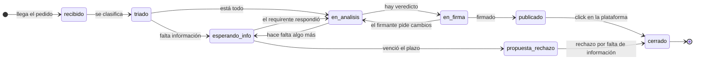

# Revisión de Arquitectura · Flujo manual

Cómo se revisa un pedido PRY de punta a punta **haciéndolo todo a mano**, sin agente, sin skills y sin la herramienta
`arq`. Sirve para dos cosas: entender el proceso si sos nuevo, y validar que cada paso tiene sentido antes de
automatizarlo. Si un paso te resulta confuso o inútil hecho a mano, también lo va a ser automatizado: avisá.

La versión con agente está en [flujo-con-agente.md](flujo-con-agente.md). Los pasos son los mismos; cambia quién
hace el trabajo repetitivo.

## 1. Qué es una revisión de Arquitectura

Un equipo carga un pedido en la **plataforma de requerimientos** (por ejemplo, levantar un servidor para probar
modelos de IA). Cada pedido tiene un código `PRY-AAAA-NNNN`. Cuatro sectores lo tienen que aprobar: Cloud,
Arquitectura, Seguridad y FinOps. La plataforma solo permite **Aprobar** o **Rechazar**, con un comentario.

Arquitectura no aprueba ni rechaza a ciegas. Antes:

1. Se asegura de que el pedido traiga la información mínima para evaluarlo.
2. Lo compara contra las reglas de Arquitectura (las *constraints*).
3. Propone el pedido original más dos opciones para su punto más débil.
4. Deja señales para Cloud, Seguridad y FinOps, sin opinar por ellos.
5. Emite un veredicto: **aprobar**, **aprobar con condiciones** o **rechazar**.

> **Importante:** en la plataforma, un rechazo es **definitivo**. El mismo PRY no se puede reabrir. Por eso nunca se
> rechaza de entrada por falta de información: primero se le pide al requirente y se le da un plazo.

Al final quedan tres cosas:

| Qué | Dónde | Para quién |
|---|---|---|
| El análisis completo (el *review*) | Documento del pedido en el repo de reviews | Arquitectura y quien quiera el detalle |
| La devolución al requirente | Su ticket en Jira (proyecto PEHD) | El equipo que pidió |
| Un comentario corto + el click en Aprobar o Rechazar | Plataforma PRY | Los otros sectores y el registro oficial |

## 2. Quién hace qué

| Rol | Quién es | Qué hace |
|---|---|---|
| **Requirente** | El "Contacto principal" del pedido | Responde las preguntas en su ticket de Jira |
| **Head** | El "Head / Stakeholder" del pedido | Sigue el ticket (queda como observador) |
| **Coordinación** | Quien gestiona la cola de pedidos | Registra, clasifica, abre los tickets, cuida el plazo y publica. **No opina de lo técnico** |
| **Architect** | Alguien de Arquitectura | Revisa la información, analiza, propone opciones y un veredicto |
| **Firmante** | Pedido simple: alguien del track técnico. Pedido complejo: el Sr Expert | Lee el análisis y lo firma, o lo devuelve con cambios |

Una misma persona puede tener más de un rol, pero conviene que quien firma no sea quien escribió el análisis.

## 3. El recorrido

Cada pedido está siempre en **un** estado. Estos son los estados y cómo se pasa de uno a otro:

| Estado | Qué significa | Quién tiene la pelota |
|---|---|---|
| `recibido` | El pedido está registrado, nadie lo miró todavía | Coordinación |
| `triado` | Ya se sabe si es simple o complejo y existen los tickets | Architect |
| `esperando-info` | Se le pidió información al requirente; corre el plazo | Requirente |
| `en-analisis` | La información está completa y se está analizando | Architect |
| `en-firma` | Hay veredicto propuesto; falta que alguien lo firme | Firmante |
| `publicado` | Firmado; se publica la devolución | Coordinación |
| `propuesta-rechazo` | Venció el plazo sin respuesta; se propone rechazar | Coordinación |
| `cerrado` | Se hizo el click en la plataforma. Fin | — |

## 4. Paso a paso, a mano

Cada paso dice **quién**, **dónde** y **cuándo está terminado**. Los nombres en *cursiva* son las tareas de Jira
que se marcan como hechas en ese paso.

### Paso 1 · Registrar el pedido (Coordinación)

1. Abrí el pedido en la plataforma PRY.
2. Creá el documento del review del pedido (`PRY-AAAA-NNNN.md`) en el repo de reviews y pegá el pedido **tal cual**,
   sin resumir ni corregir. Es la evidencia de lo que pidieron.
3. Anotá el nombre del pedido, el email del contacto principal y el del head.
4. Estado: `recibido`.

**Terminado cuando** el texto del pedido está copiado completo y hay un contacto con email. *Normalizar pedido.*

### Paso 2 · Clasificar el pedido (Coordinación)

Contestá estas seis preguntas con sí o no. No hace falta saber de tecnología. **Ante la duda, "sí".**

| Pregunta | Ojo con |
|---|---|
| ¿Toca más de una cuenta, empresa o vertical? | Si otras cuentas o verticales pueden usarlo, es "sí" aunque viva en una sola cuenta |
| ¿Es una migración o mueve datos existentes? | |
| ¿La fecha es comprometida (no negociable)? | |
| ¿Involucra a otros equipos además del que pide? | |
| ¿Incluye datos de clientes o personales, o servicios de IA externos? | |
| ¿Dura más de 3 meses o queda productivo? | Si el pedido no dice cuándo se da de baja, es "sí" |

- **Un solo "sí"** → el pedido es **complejo**.
- **Todo "no"** → es **simple**.

Anotá las respuestas y el nivel en el review. Estado: `triado`.

**Terminado cuando** las seis respuestas y el nivel están en el review. *Triage.*

### Paso 3 · Abrir los tickets en Jira y arrancar el plazo (Coordinación)

**a) La épica de trabajo, en el proyecto PLATE.** Una épica por pedido, con el título `[PRY-AAAA-NNNN] <nombre>` y
el label `pry:AAAA-NNNN`. Adentro, según el nivel:

| Pedido complejo | Pedido simple |
|---|---|
| Historia **Intake y triage**: *Normalizar pedido*, *Triage*, *Abrir ticket del requirente y plazo* | Una tarea **Revisión PRY-AAAA-NNNN** con: *Triage y apertura*, *Gap check de input mínimo*, *Análisis y opciones*, *Revisión y firma*, *Publicar devolución* |
| Historia **Análisis y opciones**: *Gap check de input mínimo*, *Análisis vs constraints*, *Opciones y recomendación* | |
| Historia **Decisión y comunicación**: *Revisión y firma*, *Publicar devolución* | |
| Opcional: historia **Validación técnica** con *Prueba acotada*, si hace falta probar algo antes de decidir | |

**b) El ticket del requirente, en el proyecto PEHD.** Es donde Arquitectura conversa con el equipo que pidió.

- Tipo `Tarea`, título `PRY-AAAA-NNNN · <nombre>`, el mismo label `pry:AAAA-NNNN`.
- **Reporter: el requirente** (no vos). Así le llegan las notificaciones a él.
- **Watcher: el head.**
- Linkealo con la épica (tipo de link `Relates`).
- Si el requirente no existe en Jira, no lo crees a tu nombre: pedí que lo den de alta primero.

**c) El plazo.** Contá **10 días hábiles** desde hoy (lunes a viernes; los feriados no se descuentan). Anotá la
fecha de vencimiento en el review y en la épica.

> Si el pedido tiene una **fecha comprometida** anterior al vencimiento, avisá: la revisión está en el camino
> crítico. Conviene pedir la información el mismo día y hacer seguimiento antes de esa fecha.

**Terminado cuando** existen la épica y el ticket, están linkeados y el plazo está anotado. *Abrir ticket del
requirente y plazo.*

### Paso 4 · Revisar si está la información mínima (Architect)

Para cada dato de esta lista, buscá en el pedido **el artefacto concreto** que lo cubre: un número, un componente, un
diagrama o una métrica. Si solo hay una frase general, cuenta como **faltante**.

| Dato | Qué tiene que traer | Nivel |
|---|---|---|
| Problema | Qué problema concreto resuelve y para quién | simple y complejo |
| Hipótesis medible | Métrica, valor actual y umbral que la valida o la refuta | simple y complejo |
| Recursos | Tipo, tamaño y cantidad de cada recurso | simple y complejo |
| Duración y baja | Cuánto dura y en qué fecha se da de baja | simple y complejo |
| Costo estimado | Costo mensual y cómo se calculó | simple y complejo |
| Responsable | Persona responsable del recurso mientras exista | simple y complejo |
| Vía de aprovisionamiento | Cómo se crea (aplicación, scope o servicio de platform) | simple y complejo |
| Diagrama C4 | Contexto y contenedores, revisable | solo complejo |
| Flujos de datos | Qué datos circulan y qué tan sensibles son | solo complejo |
| Cuentas y entornos | Origen y destino | solo complejo |
| Rollback | Cómo se vuelve atrás y cuándo se decide hacerlo | solo complejo |
| Dependencias | Con otros equipos, cada una con dueño | solo complejo |
| Requisitos no funcionales | Disponibilidad, latencia, recuperación ante fallas | solo complejo |

Revisá también que la documentación que adjuntaron esté **vigente**: si el código del repo es más nuevo que el
diagrama, manda el código.

- **Falta algo** → escribí en el review "Lo que entendimos", "Input faltante" y un análisis preliminar, **sin
  veredicto**. Redactá el pedido de información siguiendo la plantilla `jsm-pedido-info.md`: **una pregunta concreta
  por cada faltante**, nunca genérica, con el porqué. Si hay fecha comprometida, primero las preguntas que la
  bloquean. Estado: `esperando-info`.
- **Está todo** → estado `en-analisis` y pasá al paso 6.

**Terminado cuando** cada dato está marcado como presente o faltante, y, si falta algo, el pedido de información está
redactado. *Gap check de input mínimo.*

### Paso 5 · Pedir la información y esperar (Coordinación + Requirente)

1. Coordinación publica el pedido de información como comentario en el ticket PEHD, **sin cambiar el texto fijo de la
   plantilla**. En PEHD **todo comentario lo ve el requirente**: el debate técnico interno va en la épica de PLATE.
2. El requirente responde en el mismo ticket.
3. Con la respuesta, el Architect vuelve al paso 4.
4. Coordinación mira el plazo todos los días. **Si vence sin respuesta**, ir al paso 9.

**Terminado cuando** la información está completa (vuelve al paso 4 y pasa a `en-analisis`) o vence el plazo.

### Paso 6 · Analizar (Architect)

Siguiendo la plantilla `analisis.md`:

1. **Reformulá** el pedido en un párrafo.
2. **Separalo en partes:** cómputo, datos, identidad, red, aprovisionamiento, operación y costo.
3. **Evaluá cada parte** contra las constraints: `ok`, `débil` o `bloqueante`.
4. **Elegí el punto más débil** (el más grave; si empatan, el más caro o riesgoso).
5. **Opciones:** el original como opción 0, más **dos opciones solo para el punto más débil**. Cada una cumple todas
   las reglas bloqueantes y trae costo aproximado, esfuerzo, riesgo y qué tan fácil es volver atrás. Si el original
   no es viable, dos alternativas completas y qué tendría que cambiar.
6. **Recomendá** una, con condiciones verificables ("se cumple cuando…").
7. **Señales** para Cloud, Seguridad y FinOps, sin veredicto: "FinOps podría observar X, porque Y".
8. **Evidencia:** cada afirmación dice de dónde sale: el pedido, una constraint, un supuesto o "a verificar".

**Terminado cuando** cada parte tiene su evaluación y está la recomendación. *Análisis vs constraints* y *Opciones
y recomendación*.

### Paso 7 · Proponer el veredicto y firmar (Architect + Firmante)

| Situación | Veredicto |
|---|---|
| Hay una regla bloqueante sin solución | **Rechazar**, mostrando opciones que sí cumplen |
| Hay bloqueantes con solución, o reglas que condicionan | **Aprobar con condiciones** |
| Todo ok | **Aprobar**, con recomendaciones |

1. El Architect escribe el veredicto, redacta la devolución (plantilla `jsm-devolucion.md`) y el comentario corto
   para la plataforma (plantilla `comentario-pry.md`). Estado: `en-firma`.
2. No se pasa a firma si queda información faltante o no hay veredicto.
3. El firmante lee el review completo:
   - **De acuerdo** → anota su nombre como firmante. Estado: `publicado`.
   - **Pide cambios** → estado `en-analisis`. La firma anterior deja de valer: al volver hay que firmar de nuevo.

**Terminado cuando** hay firmante. *Revisión y firma.*

### Paso 8 · Publicar y cerrar (Coordinación)

1. Publicá la devolución en el ticket PEHD. **Nunca antes de la firma.**
2. Si es "aprobar con condiciones", creá en la épica **una sub-task por condición** para hacerles seguimiento.
3. Pegá el comentario corto en la plataforma PRY.
4. **Una persona** hace el click: "Aprobar" (también para "aprobar con condiciones") o "Rechazar".
5. Si el pedido es complejo y dura más de 3 meses o involucra a más de 2 equipos, se escala a un RFC en Product Brain.
   La épica de revisión se linkea con la épica de delivery que nace de ahí; no se fusionan.
6. Estado: `cerrado`, con el resultado que corresponde al veredicto (aprobado, condicionado o rechazado).

**Terminado cuando** se hizo el click en la plataforma. *Publicar devolución*, y la épica entera.

### Paso 9 · Si venció el plazo sin respuesta (Coordinación)

1. Estado: `propuesta-rechazo`.
2. Publicá en el ticket PEHD el mensaje de cierre (plantilla `jsm-cierre.md`).
3. Una persona rechaza en la plataforma, con el motivo y el link al ticket.
4. Estado: `cerrado`, resultado rechazado. El análisis y la firma quedan sin marcar: nunca hubo veredicto.

## 5. Reglas que no se negocian

- **Nunca rechazar de entrada por falta de información.** Primero se pide y se espera el plazo.
- **Arquitectura no opina por Cloud, Seguridad ni FinOps.** Les deja señales, nunca un veredicto.
- **No reescribir el pedido entero** si el original es viable: se mejora su punto más débil.
- **Todo lo que lee el requirente sale de una plantilla** y en tono profesional. Nada de texto libre.
- **No se publica la devolución sin firma**, y no se publica dos veces el mismo mensaje.
- **El click en la plataforma lo hace siempre una persona.**
- **El review es la fuente de verdad.** Jira refleja lo que dice el review, no al revés.
- **Las tareas hablan del trabajo**, nunca de la seniority de las personas.
- Las asignaciones en Jira las hace una persona a mano.

## 6. Checklist para validar el flujo con un pedido real

Tomá un pedido real y recorré los pasos a mano. Marcá cada casilla y anotá al lado lo que te costó o te sobró.

- [ ] Pude copiar el pedido completo y encontrar el email del contacto y del head.
- [ ] Contesté las seis preguntas de clasificación sin necesitar ayuda técnica.
- [ ] Creé la épica con sus historias y sub-tasks según el nivel.
- [ ] Creé el ticket PEHD a nombre del requirente, con el head de watcher, y lo linkeé con la épica.
- [ ] Calculé el vencimiento en 10 días hábiles y lo anoté.
- [ ] Para cada dato mínimo pude decir "está" o "falta" señalando algo concreto del pedido.
- [ ] Cada pregunta al requirente es específica de este pedido.
- [ ] El requirente entendió las preguntas sin pedir aclaraciones.
- [ ] El análisis tiene evaluación por parte, original + 2 opciones y una recomendación con condiciones.
- [ ] El firmante pudo decidir leyendo solo el review.
- [ ] La devolución y el comentario corto salieron de sus plantillas.
- [ ] En cada momento pude decir en qué estado estaba el pedido y quién tenía la pelota.
- [ ] Al final, las tareas de Jira reflejaban lo que decía el review.

## 7. Glosario

| Palabra | Qué quiere decir |
|---|---|
| **PRY** | Pedido en la plataforma de requerimientos. Código `PRY-AAAA-NNNN` |
| **Review** | El documento con todo el análisis de un pedido. Es la fuente de verdad |
| **Constraints** | Las reglas de Arquitectura. Pueden ser bloqueantes, condicionantes o recomendaciones |
| **Triage** | Clasificar el pedido como simple o complejo con las seis preguntas |
| **Gap check** | Revisar qué información mínima falta |
| **Componente más débil** | La parte del pedido que peor cumple las reglas. Las opciones se proponen para esa parte |
| **Señales** | Advertencias para Cloud, Seguridad o FinOps, sin veredicto |
| **Veredicto** | Aprobar, aprobar con condiciones o rechazar |
| **Plazo** | 10 días hábiles para que el requirente complete la información |
| **Épica** | El contenedor en Jira (proyecto PLATE) con todas las tareas de revisión de un pedido |
| **PEHD** | El proyecto de Jira donde se conversa con el requirente. Todo comentario es público |
| **Head** | El responsable del área que pide. Sigue el ticket |
| **RFC** | Propuesta formal en Product Brain, para pedidos grandes que pasan a delivery |
