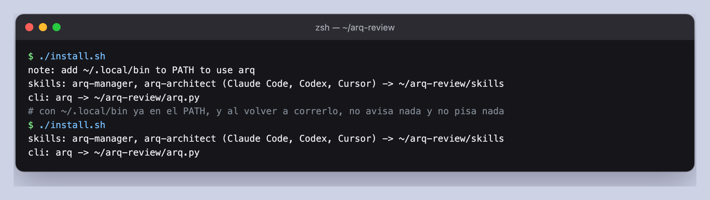
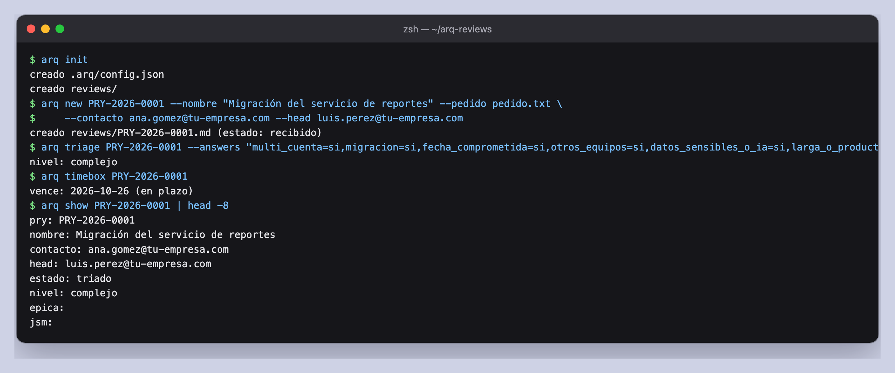
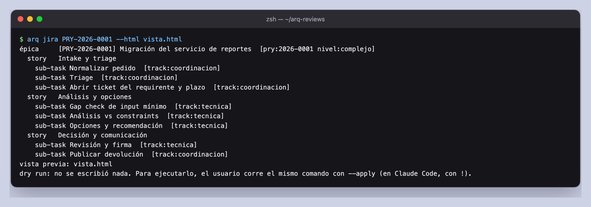

# Instalación detallada

> **¿Preferís no tocar la terminal?** La [guía con prompts](instalacion.md) hace el mismo recorrido hablándole al agente
> de Cursor. Esta página es la versión comando por comando: qué corre cada paso, qué imprime y qué escribe.

Todas las capturas de terminal son salida **real**, corrida sin red sobre un repo de reviews de prueba con un pedido
inventado (`PRY-2026-0001`). Las rutas están acortadas a `~/…` y los datos son ficticios.

| Paso | Qué hacés |
|---|---|
| [1. Requisitos](#1-requisitos) | Verificar `python3` y `git` |
| [2. Instalar](#2-instalar) | `./install.sh`: skills y comando `arq` |
| [3. Credenciales de Jira](#3-credenciales-de-jira) | Crear el token y cargar tres variables |
| [4. El repo de reviews](#4-el-repo-de-reviews) | `arq init` y `.arq/config.json` |
| [5. Un pedido, de punta a punta](#5-un-pedido-de-punta-a-punta) | Cada comando del recorrido |
| [6. Comprobar la instalación](#6-comprobar-la-instalación) | La suite de tests |

## 1. Requisitos

- `python3` 3.9 o más. `arq` usa solo la biblioteca estándar: no hay nada que instalar con `pip`.
- `git`, y acceso por SSH a `josefigueredo` (el repo es privado).
- Un editor o agente de código que lea skills: Claude Code, Codex o Cursor.
- Para las escrituras en Jira y para `arq ver`: un sitio de Jira Cloud y un token de API (paso 3).
- Para regenerar las guías HTML de `docs/guias/` (solo si modificás esas guías): `pandoc` y `mmdc`.

## 2. Instalar

```bash
git clone git@github.com:josefigueredo/arch-review.git arq-review
cd arq-review && ./install.sh
```



*Salida real, con un `HOME` de prueba y rutas acortadas.*

Qué hace, y qué no:

- Enlaza `~/.agents/skills/<skill>` a las carpetas `skills/` del clon, y `~/.claude/skills` y `~/.codex/skills` a esos
  enlaces. Cursor lee `~/.agents/skills` directamente.
- Deja `~/.local/bin/arq` apuntando a `arq.py`.
- **No copia nada** y repetirlo es seguro. Si ya existe un archivo o carpeta real con el mismo nombre, **no lo pisa**:
  el instalador avisa cuál es y termina con código `1`. Movelo y volvé a correrlo.
- Si `~/.local/bin` no está en el `PATH`, avisa: agregalo a tu `~/.zshrc` y abrí una terminal nueva. Comprobá con
  `arq --help`.

## 3. Credenciales de Jira

Solo las necesitan los comandos que entran a Jira: los que llevan `--apply` y `arq ver`. Todo lo demás (`init`, `new`,
`show`, `triage`, `set`, `state`, `timebox`, `lint`, `eval` y los dry run) funciona sin red.

**a) Creá un token de API** en [id.atlassian.com → Seguridad → Tokens de API](https://id.atlassian.com/manage-profile/security/api-tokens)
(**Create API token**, con nombre y vencimiento; se muestra una sola vez). [Guía oficial](https://support.atlassian.com/atlassian-account/docs/manage-api-tokens-for-your-atlassian-account/).

> **Sin alcance.** Usá el botón «Create API token», no «Create API token with scopes». `arq` entra por la URL de tu
> sitio (`JIRA_BASE_URL`) con autenticación básica (email y token). Según la documentación de Atlassian, un token con
> alcance se usa a través de `api.atlassian.com`, que `arq` no usa.

**b) Guardá tres variables.** `arq` las lee del entorno; no lee ningún archivo. Por eso la forma recomendada es un `.env`
**fuera del repo de reviews** (ese repo se commitea) y cargarlo en la misma línea del comando:

```bash
# ~/.config/arq/.env   (la ruta es un ejemplo; que no esté dentro de ningún repo)
JIRA_BASE_URL="https://tu-empresa.atlassian.net"
JIRA_EMAIL="vos@tu-empresa.com"
JIRA_API_TOKEN="el-token-que-copiaste"
```

```bash
set -a && source ~/.config/arq/.env && set +a && arq jira PRY-2026-0001 --apply
```

`JIRA_BASE_URL` tiene que empezar con `https://`: el token viaja en cada request, y `arq` se niega a usar otra cosa.

**c) Comprobá.** Faltando alguna, `arq` no escribe nada y lo dice:

```text
error: faltan variables de entorno: JIRA_BASE_URL, JIRA_EMAIL, JIRA_API_TOKEN
```

Con las tres cargadas, la prueba de que entran es `arq ver PRY-2026-0001` (solo lectura) sobre un pedido que ya tenga
épica. Esa salida depende de tu Jira y no se muestra acá; el [showcase](showcase.md#3-cómo-viene-un-pedido) muestra su
formato en una maqueta.

## 4. El repo de reviews

`arq` trabaja sobre el **directorio actual**, que es el repo de reviews de tu equipo, separado de esta herramienta.
Parado ahí:

```bash
arq init          # crea .arq/config.json y reviews/ (si ya existen, no los toca)
```

Después editá `.arq/config.json` con el canal del requirente y los proyectos de tu equipo. El archivo completo y las
claves de cada canal están en la [referencia](referencia.md#repo-de-reviews-del-equipo). Comprobá el contrato con:

```bash
arq path          # imprime la carpeta del contrato (constraints, triage, input mínimo, plantillas)
arq lint          # valida constraints.md; imprime «ok: <ruta>»
```

El contrato lo mantiene Arquitectura: `arq` lo lee, nunca lo reescribe.

## 5. Un pedido, de punta a punta

El recorrido completo con los comandos que corren las skills. Las capturas muestran la etapa de registro y las del Jira;
el resto está en el [showcase](showcase.md).

### Registrar, clasificar y arrancar el plazo

```bash
arq new PRY-2026-0001 --nombre "Migración del servicio de reportes" --pedido pedido.txt \
    --contacto ana.gomez@tu-empresa.com --head luis.perez@tu-empresa.com
arq triage PRY-2026-0001 --answers "multi_cuenta=si,migracion=si,fecha_comprometida=si,otros_equipos=si,datos_sensibles_o_ia=si,larga_o_productiva=no"
arq timebox PRY-2026-0001
```



*Salida real. El `--pedido` acepta `-` para leer de la entrada estándar. Las seis preguntas y sus criterios están en
`contract/triage.md`; un solo «sí» da nivel `complejo`.*

### Ver qué se crearía en Jira (dry run) y crearlo

```bash
arq jira PRY-2026-0001 --html vista.html          # dry run: tabla en consola y página HTML; no escribe nada
arq jira PRY-2026-0001 --con-validacion           # lo mismo, con la historia opcional de validación técnica
set -a && source ~/.config/arq/.env && set +a && arq jira PRY-2026-0001 --apply   # escribe en Jira
```



*Salida real del dry run. Sin `--apply` no se necesita ninguna credencial.*

Con `--apply`, `arq` crea la épica, las historias y sub-tasks y el ticket del requirente (según el canal), guarda
`epica` y `jsm` en el frontmatter del review y registra cada escritura en `.arq/jira-writes.jsonl`. Volver a correrlo no
duplica: cada issue lleva un ID estable (`arq.node`), de modo que renombrar un issue en Jira es seguro. Después de cada
cambio del review se vuelve a correr, y también pasa a Done las tareas cumplidas.

### El resto de los comandos

| Etapa | Comando | ¿Escribe en Jira? |
|---|---|---|
| Gap check | `arq set PRY faltantes=id1,id2` · `arq state PRY --to esperando-info` | No |
| Pedido de información | `arq jsm PRY --file reviews/PRY.jsm.md --public --template jsm-pedido-info.md [--apply]` | Solo con `--apply` |
| Análisis | `arq set PRY componente_debil=… senales=… veredicto=…` · `arq state PRY --to en-firma` | No |
| Firma | `arq set PRY firmante=<usuario>` · `arq state PRY --to publicado` | No |
| Devolución | `arq jsm PRY --file … --public --template jsm-devolucion.md [--apply]` | Solo con `--apply` |
| Condiciones | `arq seguimiento PRY "condición 1" "condición 2" [--apply]` | Solo con `--apply` |
| Escalar a RFC | `arq link EPICA-ARQ EPICA-DELIVERY [--apply]` | Solo con `--apply` |
| Cierre | `arq state PRY --to cerrado --resultado condicionado` | No |
| Estado en Jira | `arq ver PRY [--sin-links]` | No (solo lectura, pide credenciales) |
| Tuning | `arq eval tests/golden/<PRY> reviews/<PRY>.md` | No |

Cada comando con `--apply` es un dry run sin él, e imprime `dry run: no se escribió nada`. La referencia describe cada
uno en la [tabla de comandos](referencia.md#comandos).

## 6. Comprobar la instalación

```bash
python3 -m unittest discover -s tests -v          # con Jira falso, sin red
/usr/bin/python3 -m unittest discover -s tests    # compatibilidad con el python3 3.9 del sistema
```

Los tests nunca salen a la red: usan un Jira falso. Si pasan, el código y las skills son coherentes entre sí (por
ejemplo, que las skills solo nombren subcomandos que existen y nunca corran `--apply` sin `!`).
