# Instalación y primer uso, desde Cursor

Todo esto se hace conversando con el agente de Cursor: no hace falta aprender ningún comando. Le pedís las cosas y él
corre `arq` por vos. Cuatro cosas **no** son un prompt, y es a propósito:

- **El token de Jira** es un secreto: lo creás y lo guardás vos, y nunca lo pegues en el chat.
- **Los comandos que escriben en Jira** (los que llevan `--apply`) los corrés vos, en la terminal de Cursor. El agente
  te los pasa armados; no los corre. No hay una ventana de aprobación: tu control es el dry run que ves antes.
- **El click en Aprobar o Rechazar** de la plataforma PRY es de una persona.
- **La firma** del review la pone quien firma, no el agente que lo redactó.

> ¿Preferís ver (o correr) cada comando? Está la [instalación detallada](instalacion-detallada.md), con los comandos
> uno por uno. Para ver todo lo que hace la herramienta, el [showcase](showcase.md).

| Paso | Qué hacés | Cómo |
|---|---|---|
| [1. Instalar](#1-instalar) | Dejar las skills y `arq` andando | Un prompt |
| [2. Preparar el repo de reviews](#2-preparar-el-repo-de-reviews) | Inicializarlo y elegir el canal del requirente | Un prompt |
| [3. Credenciales de Jira](#3-credenciales-de-jira) | Crear un token y guardarlo | Manual + un prompt |
| [4. Registrar y clasificar un pedido](#4-registrar-y-clasificar-un-pedido) | Pasar el pedido a un review y darle nivel | Prompts + tu confirmación |
| [5. Abrir el Jira](#5-abrir-el-jira) | Ver la vista previa y crear la épica y el ticket | Un prompt + un comando tuyo |
| [6. Pedir la información que falta](#6-pedir-la-información-que-falta) | Gap check y pedido al requirente | Prompts + un comando tuyo |
| [7. Analizar, firmar y cerrar](#7-analizar-firmar-y-cerrar) | Análisis, firma, devolución y cierre | Prompts + comandos tuyos |
| [8. Ver cómo viene](#8-ver-cómo-viene) | El árbol de la épica con su avance | Un comando tuyo |

> **Sobre las capturas.** Son **maquetas** de Cursor: muestran cómo se ve la conversación, no una sesión grabada, y el
> texto del agente es ilustrativo. Los bloques `Ran` reproducen la salida **real** de esos comandos, corridos sin red
> sobre un repo de reviews de prueba; los que dependen de tu Jira (el estado de la épica, la creación de issues, el
> contenido del análisis) no llevan salida o están marcados como maqueta. Todos los pedidos, nombres y emails son
> inventados (`PRY-2026-0001`, Ana Gómez, `tu-empresa.com`). [Tabla con el origen de cada imagen](#de-dónde-sale-cada-captura).

---

## 1. Instalar

Necesitás `python3` 3.9 o más, `git` y acceso por SSH a `josefigueredo` (el repo es privado). Abrí cualquier
carpeta en Cursor y pedile:

> Instalá arq-review: cloná git@github.com:josefigueredo/arch-review.git en arq-review y corré ./install.sh

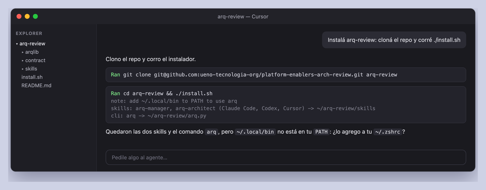

*El bloque «Ran» del instalador es la salida real (rutas acortadas); el clon se muestra sin salida.*

Qué pasó:

- **Dos skills** quedaron disponibles en Claude Code, Codex y Cursor: `arq-manager` (coordina) y `arq-architect`
  (revisa lo técnico).
- **El comando `arq`** quedó en `~/.local/bin`. Es lo que las skills usan por detrás.
- **No se copió nada**: son enlaces a tu clon, así que hay una sola fuente de verdad. Instalar de nuevo es seguro y
  nunca pisa un archivo real: si encuentra uno con el mismo nombre, avisa y termina con error.

Si el instalador avisa `add ~/.local/bin to PATH to use arq` (como en la captura), pedile al agente que lo agregue
(«agregá ~/.local/bin al PATH en mi ~/.zshrc») y abrí una terminal nueva.

## 2. Preparar el repo de reviews

`arq` no trabaja sobre este repo sino sobre **el repo de reviews de tu equipo** (donde vive cada review y el registro de
lo que se escribió en Jira). Cloná ese repo, abrilo en Cursor, y pedile:

> Inicializá este repo de reviews. El canal del requirente es el help desk de Software, proyecto DEMOHD, tipo de issue Task, y las épicas van en el proyecto DEMO

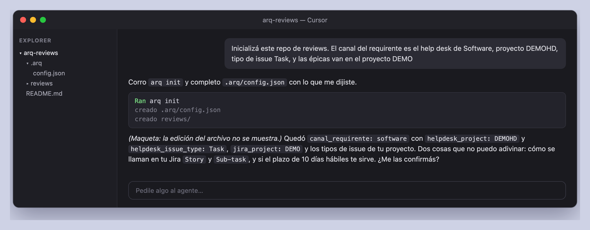

*El bloque «Ran» es la salida real de `arq init`; la edición de `config.json` y la conversación son una maqueta.*

Cambiá `DEMOHD`, `DEMO` y los tipos de issue por los de tu equipo. Hay dos canales para el requirente, y el agente te
va a preguntar cuál es el tuyo:

- **`software`**: el requirente conversa en un proyecto de Software usado como help desk (`helpdesk_project` y
  `helpdesk_issue_type`). En este canal no hay notas internas: todo comentario lo ve el requirente.
- **`jsm`**: un pedido de Jira Service Management (`jsm_project`, `jsm_service_desk_id` y `jsm_request_type_id`).

El archivo completo, con sus claves, está en la [referencia](referencia.md#repo-de-reviews-del-equipo).

## 3. Credenciales de Jira

Solo las escrituras (`--apply`) y `arq ver` entran a Jira. Lo hacés vos, en tres tramos.

**a) Creá un token de API.** Entrá a [id.atlassian.com → Seguridad → Tokens de API](https://id.atlassian.com/manage-profile/security/api-tokens),
apretá **Create API token**, poné un nombre y un vencimiento y **Copy to clipboard**. Se muestra una sola vez.
[Guía oficial](https://support.atlassian.com/atlassian-account/docs/manage-api-tokens-for-your-atlassian-account/).

> **Creá el token sin alcance: el botón «Create API token», no «Create API token with scopes».** `arq` entra por la URL
> de tu sitio con tu email y el token (autenticación básica). Según la documentación de Atlassian, un token con alcance
> se usa a través de `api.atlassian.com`, que `arq` no usa.

**b) Guardá tres variables en un archivo `.env` fuera del repo de reviews** (ese repo se commitea; el token no), con un
editor, no por el chat:

```bash
JIRA_BASE_URL="https://tu-empresa.atlassian.net"   # la URL que ves cuando abrís Jira, con https
JIRA_EMAIL="vos@tu-empresa.com"                     # el email con el que entrás a Jira
JIRA_API_TOKEN="el-token-que-copiaste"
```

`arq` solo lee el entorno, no el archivo: por eso el comando con `--apply` que te da el agente carga el `.env` en la
misma línea (`set -a && source <ruta>/.env && set +a && arq ...`). Si preferís exportarlas desde tu `~/.zshrc`, cerrá
Cursor del todo y abrilo de nuevo para que las vea.

**c) Comprobá que están, sin mostrar el token.** Pedile:

> Comprobá que las tres variables de Jira están definidas, sin mostrarme ningún valor

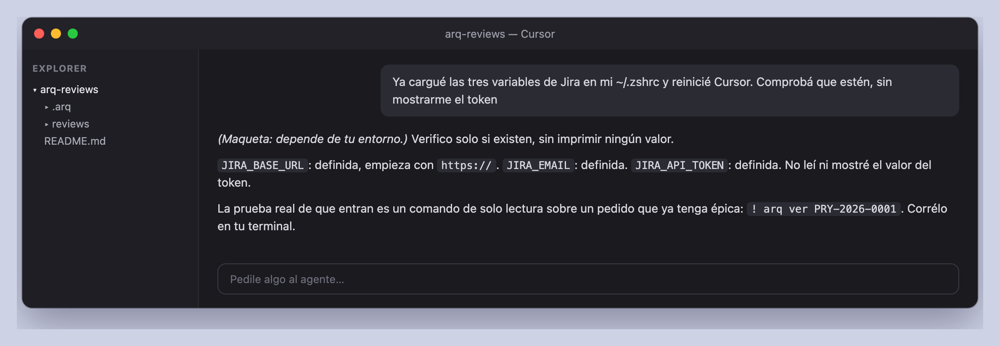

*Maqueta completa: depende de tu entorno.*

Que existan no prueba que entren. La prueba real es el paso 8 (`arq ver`, solo lectura) sobre un pedido que ya tenga
épica, o el primer `--apply` del paso 5. Si faltan, `arq` lo dice y no escribe nada: `error: faltan variables de
entorno: JIRA_BASE_URL, JIRA_EMAIL, JIRA_API_TOKEN`.

## 4. Registrar y clasificar un pedido

Pegale el pedido completo (o guardalo en un archivo) y pedile:

> Registrá el PRY-2026-0001. El pedido está en pedido.txt; contacto ana.gomez@tu-empresa.com y head luis.perez@tu-empresa.com

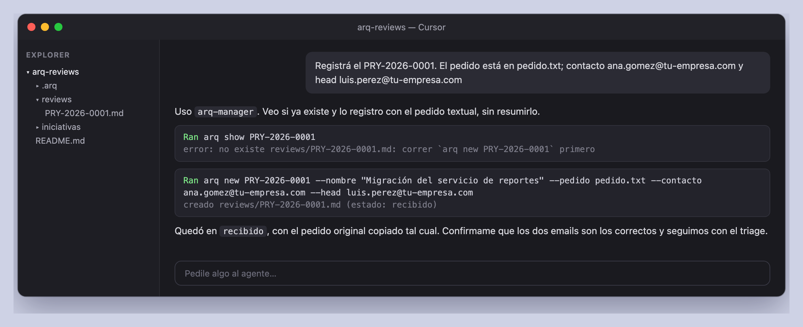

*Los bloques «Ran» son salida real; la conversación es una maqueta.*

El agente transcribe el pedido **textual**, sin resumirlo ni corregirlo: es evidencia. El «contacto principal» es el
requirente y el «head» es quien queda de participante. Después:

> Hacé el triage del PRY-2026-0001

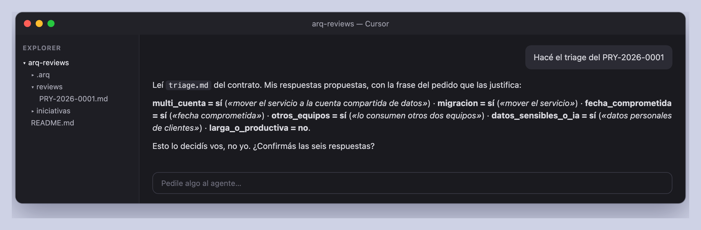

*Maqueta.*

**Las respuestas las confirmás vos**, no el modelo. Ante la duda, «sí». Con un solo «sí» el nivel es `complejo`; con
todos «no», `simple`:

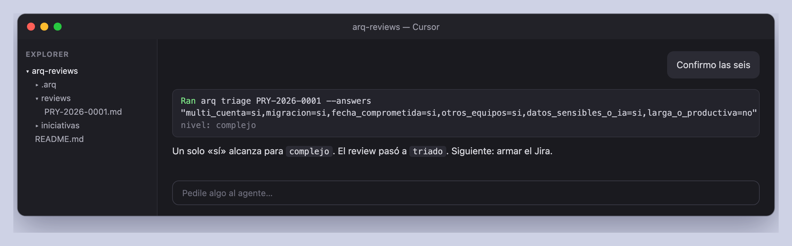

*El bloque «Ran» es salida real.*

## 5. Abrir el Jira

> Armá el Jira del PRY-2026-0001

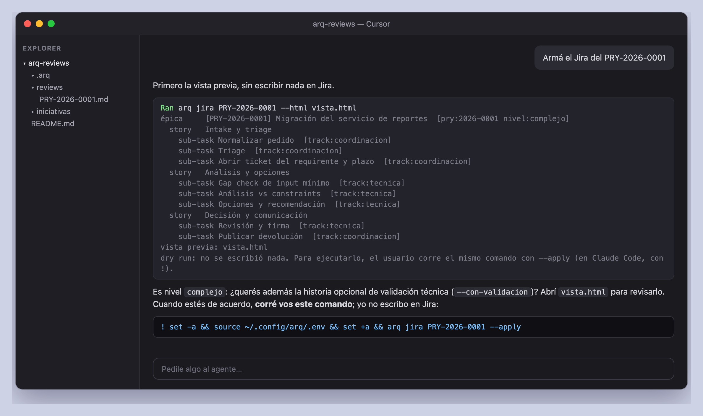

*El bloque «Ran» es salida real del dry run; la conversación es una maqueta.*

El agente hace tres cosas, en este orden, y **hasta la tercera no escribe nada en Jira**:

1. **Te muestra qué se crearía**: la épica, sus historias y sub-tasks, en consola y en una página `vista.html`. Abrila
   y revisala.
2. **Si el nivel es `complejo`, te pregunta** si hace falta la historia opcional de validación técnica.
3. **Te pasa el comando para crear** y lo corrés vos, en la terminal de Cursor.

Ese comando crea la épica en tu proyecto de épicas y el ticket del requirente **a su nombre** (lo busca en Jira por
email), con el head de participante o watcher, y los linkea. Si algo falla a mitad de camino, **repetí el mismo
comando**: retoma sin duplicar. Si dice que no encontró a alguien, hay que darlo de alta en Jira y repetirlo; si dice que
Jira rechazó el reporter, a la cuenta le falta el permiso «Modify reporter».

> Después de cada paso que cambia el review, el agente te vuelve a dar el mismo comando `arq jira ... --apply`: así Jira
> muestra lo mismo que git (la descripción de la épica y las tareas hechas). No edites las descripciones a mano en
> Jira: se pisan. Las notas van en comentarios.

## 6. Pedir la información que falta

> Hacé el gap check del PRY-2026-0001

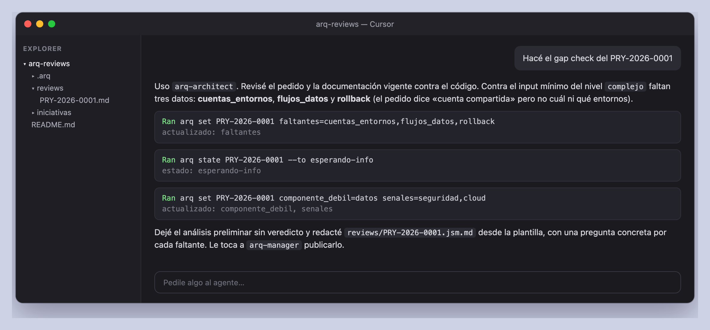

*Los bloques «Ran» son salida real; el razonamiento del agente es una maqueta.*

`arq-architect` contrasta el pedido y su documentación contra el input mínimo del nivel. Si falta algo, deja el
análisis preliminar **sin veredicto** y redacta, desde una plantilla, una pregunta concreta por cada faltante. Le toca a
`arq-manager` publicarlo:

> Publicá el pedido de información del PRY-2026-0001

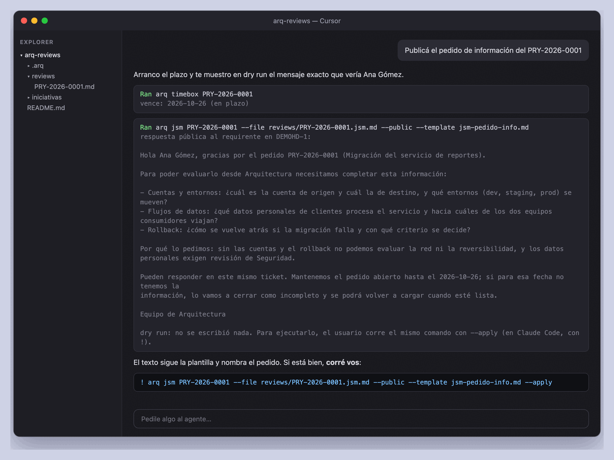

*Los bloques «Ran» son salida real, con un review de prueba que ya tenía su ticket (en tu caso lo crea el paso 5).*

Leé el mensaje: es lo que va a ver el requirente. Si está bien, corrés vos el comando con `--apply`. El plazo se fija a
10 días hábiles por defecto (`timebox_dias_habiles` en el `config.json`), la primera vez, y después solo se consulta.

## 7. Analizar, firmar y cerrar

Cuando el requirente responde en su ticket:

> Ana respondió en el ticket. Revisá de nuevo y analizá el PRY-2026-0001

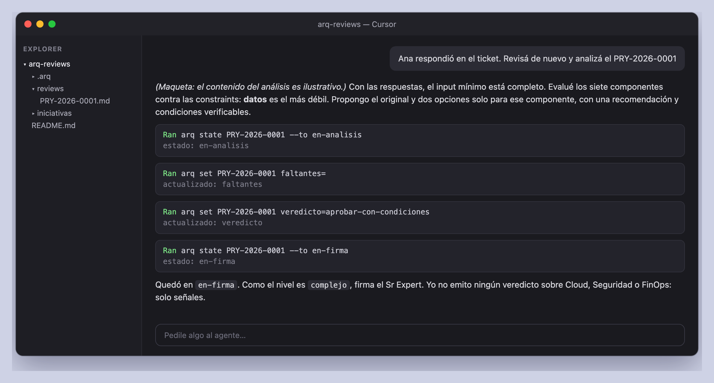

*Los bloques «Ran» son salida real; el contenido del análisis es una maqueta.*

El agente propone el original más dos opciones para el componente más débil, las señales para Cloud, Seguridad y
FinOps (nunca un veredicto sobre ellas) y un veredicto. **No firma**: pasa el review a `en-firma`. Quien firma lo lee
completo (`reviews/PRY-2026-0001.md`):

> Revisé el análisis y estoy de acuerdo. Firmo como luis.firma

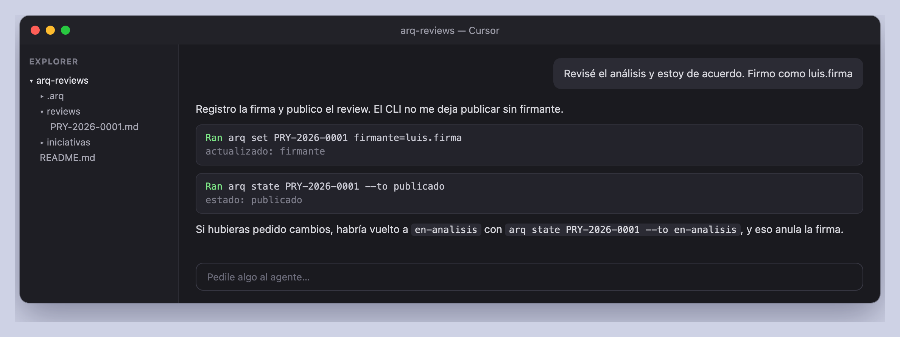

*Los bloques «Ran» son salida real.*

Si en cambio pide cambios, el review vuelve a `en-analisis` y **la firma se anula**: hay que firmar de nuevo. Con el
review publicado:

> Publicá la devolución del PRY-2026-0001

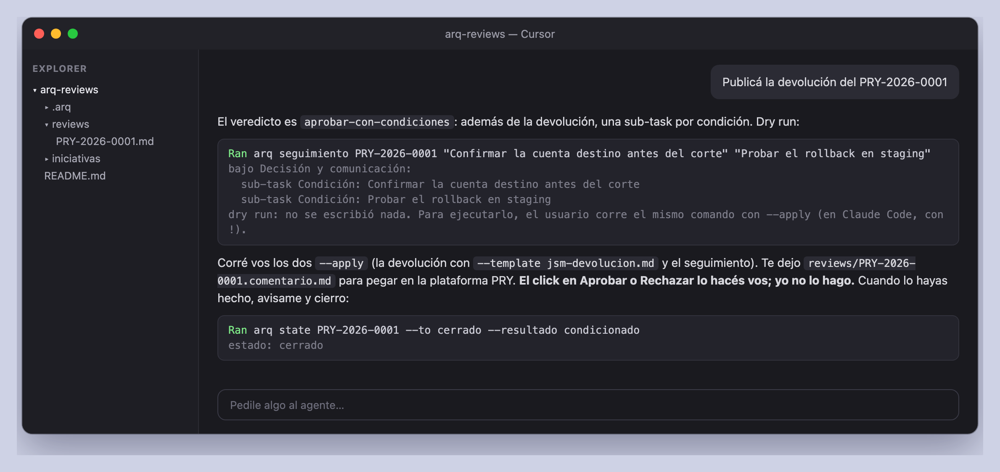

*El bloque «Ran» del seguimiento es salida real; el cierre se muestra tal como queda cuando confirmás el click.*

Te toca a vos: correr los comandos `--apply` de la devolución y del seguimiento, pegar el comentario corto en la
plataforma PRY y **hacer el click en Aprobar o Rechazar** («aprobar con condiciones» se publica como Aprobar). Recién
cuando confirmás ese click, el agente cierra el pedido con el resultado que corresponde al veredicto.

Si el plazo vence con el pedido en `esperando-info`, el agente te lo avisa y el camino es la propuesta de rechazo: lo
muestra el [showcase](showcase.md#7-plazo-vencido).

## 8. Ver cómo viene

`arq ver` lee Jira en vivo y **no escribe nada**, pero necesita las credenciales en el entorno. Como las claves son links
clickeables solo en tu terminal, el agente te da el comando para que lo corras vos:

> ¿Cómo viene el PRY-2026-0001?

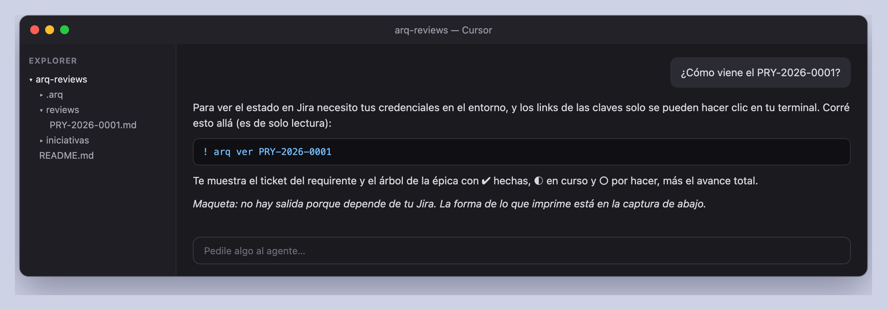

*Maqueta completa: depende de tu Jira. El formato de lo que imprime está en el [showcase](showcase.md#3-cómo-viene-un-pedido).*

## Si algo falla

| Qué pasa | Qué hacer |
|---|---|
| El agente dice que `arq` no existe | `~/.local/bin` no está en el `PATH`. Pedile que lo agregue a tu `~/.zshrc` y abrí una terminal nueva |
| `error: faltan variables de entorno: …` | Cargaste el `.env` en la misma línea del comando, o exportaste las tres variables y reiniciaste Cursor (paso 3b) |
| No entra con un token recién creado | Casi seguro lo creaste **con alcance**. Creá otro con el botón sin alcance |
| `error: falta …/.arq/config.json: correr arq init` | Estás parado en otra carpeta: abrí Cursor en el repo de reviews, o pedile `arq init` (paso 2) |
| `error: transición inválida: …` | El review no está en el estado que el paso necesita. Pedile `arq show` y que te diga en cuál está y qué sigue |
| `error: el texto no sigue la plantilla …` | Pedile que redacte el mensaje desde la plantilla del contrato, completando solo los placeholders |
| `error: el help desk no tiene notas internas` | Estás en el canal `software`: el debate técnico va en la épica, no en un comentario del ticket |
| La creación en Jira falló a la mitad | Repetí el mismo comando `arq jira … --apply`: retoma sin duplicar |

## De dónde sale cada captura

| Imagen | Origen |
|---|---|
| `cursor-instalar.png` | Maqueta. El bloque `Ran` del instalador es la salida real (con `HOME` de prueba, rutas acortadas) |
| `cursor-repo.png` | Maqueta. El bloque `Ran` es la salida real de `arq init` |
| `cursor-registrar.png`, `cursor-triage-ok.png` | Maqueta. Los bloques `Ran` son la salida real de `arq show`, `arq new` y `arq triage` |
| `cursor-jira.png` | Maqueta. El bloque `Ran` es la salida real del dry run de `arq jira --html` |
| `cursor-gapcheck.png`, `cursor-analisis.png`, `cursor-firma.png` | Maqueta. Los bloques `Ran` son la salida real de `arq set` y `arq state`; el análisis es ilustrativo |
| `cursor-pedido-info.png` | Maqueta. Los bloques `Ran` son la salida real de `arq timebox` y del dry run de `arq jsm`, con el ticket cargado a mano en un review de prueba |
| `cursor-cierre.png` | Maqueta. Los bloques `Ran` son la salida real de `arq seguimiento` (dry run) y `arq state` |
| `cursor-triage.png`, `cursor-credenciales.png`, `cursor-ver.png` | **Maqueta completa**: sin salida o con respuestas ilustrativas. Dependen de tu pedido, tu entorno o tu Jira |

Las fuentes de cada captura están en [`img/src/`](img/src/), por si hay que regenerarlas.
