# Showcase

Qué se puede hacer con `arq-review`, escenario por escenario: qué le decís al agente, qué comandos corre por detrás y qué
ves en pantalla. Para instalarlo, la [guía de instalación](instalacion.md) (con prompts de Cursor) o la
[detallada](instalacion-detallada.md) (con comandos); para cada comando y regla, la [referencia](referencia.md).

| Skill | Escenario | Ir al caso |
|---|---|---|
| `arq-manager` | «Registrá el PRY-2026-0001», «hacé el triage» | [Registrar y clasificar](#1-registrar-y-clasificar-un-pedido) |
| `arq-manager` | «Armá el Jira del PRY-2026-0001» | [Armar el Jira](#2-armar-el-jira-del-pedido) |
| `arq-manager` | «¿Cómo viene el PRY-2026-0001?» | [Cómo viene un pedido](#3-cómo-viene-un-pedido) |
| `arq-architect` + `arq-manager` | «Hacé el gap check» y «publicá el pedido de información» | [Gap check y pedido de información](#4-gap-check-y-pedido-de-información) |
| `arq-architect` | «Analizá el PRY-2026-0001» | [Análisis y veredicto](#5-análisis-y-veredicto) |
| `arq-manager` | «Firmo como…», «publicá la devolución», «cerrá el pedido» | [Firma, devolución y cierre](#6-firma-devolución-y-cierre) |
| `arq-manager` | El plazo venció y el requirente no respondió | [Plazo vencido](#7-plazo-vencido) |
| `arq-architect` | «Evaluá este review contra el golden case» | [Tuning con golden cases](#8-tuning-con-golden-cases) |
| `arq` (CLI) | Qué le impide al agente (o a vos) saltearse un paso | [Las guardas del CLI](#9-las-guardas-del-cli) |

> **Sobre las salidas.** Todo corre sobre un pedido **inventado** (`PRY-2026-0001`, Ana Gómez, `tu-empresa.com`) en un
> repo de reviews de prueba. Las salidas de `arq` que no necesitan red (registrar, clasificar, estado, plazo, dry run,
> guardas, `eval`) son **reales**. Lo que depende de Jira (crear issues, publicar, `arq ver`) **no se corrió**: se
> muestra el comando y lo que responde el agente, y la captura de `arq ver` es una maqueta marcada como tal. La
> conversación de Cursor es siempre una maqueta, y el contenido del análisis es ilustrativo.

---

## Lo que lo distingue

| | |
|---|---|
| **Dry run por defecto** | Ningún comando escribe en Jira sin `--apply`, y el `--apply` lo corrés vos: las skills nunca lo corren (un test lo verifica). No hay una ventana de aprobación: tu control es el dry run que ves antes |
| **Una persona decide** | El triage lo confirmás vos, la firma la pone una persona y el click en Aprobar o Rechazar de la plataforma PRY también. El agente prepara; no decide |
| **Estado con guardas** | El review sigue una máquina de estados: no se pasa a firma sin veredicto ni con input faltante, ni se publica sin firmante, y reabrir el análisis anula la firma |
| **Lo público sigue una plantilla** | Todo mensaje al requirente sale de una plantilla `jsm-*.md`, nombra su PRY, respeta el estado del pedido y no se publica dos veces |
| **No duplica** | Cada issue lleva un ID estable (`arq.node`): volver a correr un comando, o renombrar un issue en Jira, no crea otro |
| **Registro** | Cada escritura en Jira queda en `.arq/jira-writes.jsonl` del repo de reviews, que se commitea |

---

## 1. Registrar y clasificar un pedido

**Skill:** `arq-manager` · **Escribe en Jira:** no.

Llegó un pedido por la plataforma PRY y alguien tiene que dejarlo registrado y decidir su nivel.

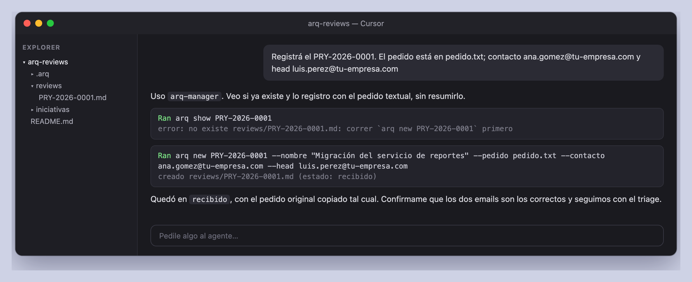

*Maqueta de la conversación; los bloques «Ran» son salida real.*

### Qué corre el agente

| # | Comando | Para qué | ¿Escribe en Jira? |
|---|---|---|---|
| 1 | `arq show PRY-2026-0001` | Ver si el review ya existe y en qué estado está | No |
| 2 | `arq new PRY-2026-0001 --nombre … --pedido pedido.txt --contacto … --head …` | Crear el review en `recibido`, con el pedido textual | No |
| 3 | *(lee `contract/triage.md`)* | Proponer sí o no para las seis preguntas, citando el pedido | No |
| 4 | `arq triage PRY-2026-0001 --answers "id=si\|no,…"` | Fijar el nivel; se puede repetir hasta que exista la épica | No |

### Lo que ves

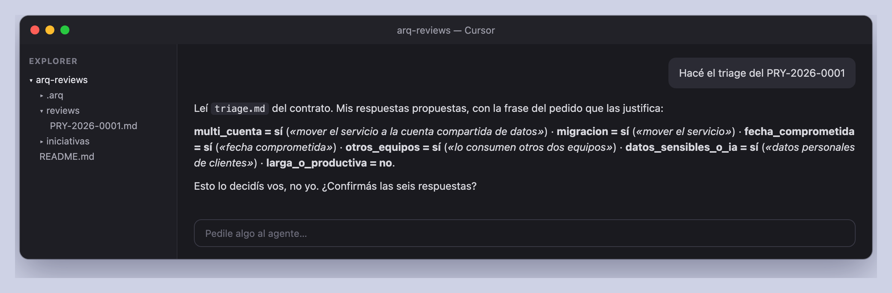

Las respuestas las confirmás vos: contesta la persona que coordina, no el modelo. Ante la duda, «sí». Un solo «sí» da
nivel `complejo`; con todos «no», `simple`.

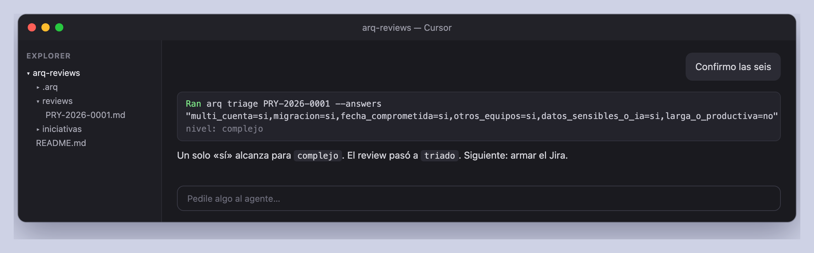

Lo mismo, sin agente, en la terminal:

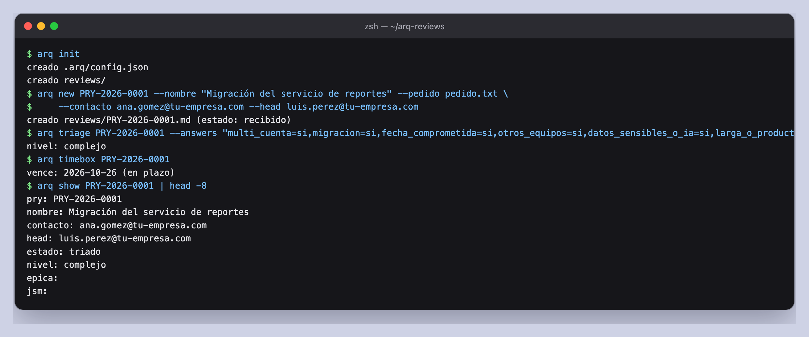

**Qué te protege**

| Situación | Resultado |
|---|---|
| El `PRY` no tiene el formato `PRY-AAAA-NNNN` | `arq new` lo rechaza |
| El email del contacto o del head es inválido | `arq new` lo rechaza |
| El review ya existe | `arq new` no lo pisa y te manda a `arq show` |
| Ya existe la épica y querés cambiar el nivel | `arq triage` se niega: el nivel decide la estructura de Jira |

## 2. Armar el Jira del pedido

**Skill:** `arq-manager` · **Escribe en Jira:** sí, cuando corrés `--apply`.

El review está `triado` y hay que abrir la épica de revisión y el ticket donde conversa el requirente.

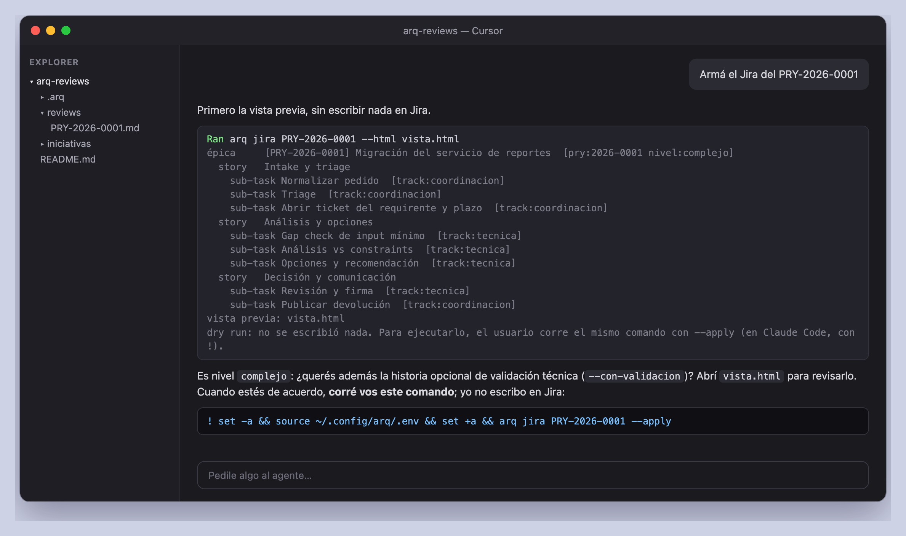

*Maqueta; el bloque «Ran» es la salida real del dry run.*

### Qué corre el agente

| # | Comando | Para qué | ¿Escribe en Jira? |
|---|---|---|---|
| 1 | `arq jira PRY-2026-0001 --html vista.html` | Dry run: el árbol de lo que se crearía y una página de vista previa | No (offline) |
| 2 | *(te pregunta, si el nivel es `complejo`)* | Si hace falta la historia opcional de validación técnica (`--con-validacion`) | No |
| 3 | `arq jira PRY-2026-0001 --apply` | Crear. **Lo corrés vos** | Sí |

### Lo que ves en la terminal

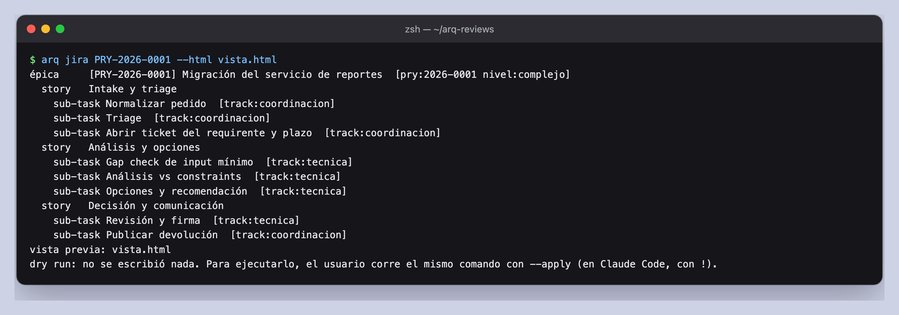

Una épica por pedido, con tres historias (intake y triage, análisis y opciones, decisión y comunicación) y sus
sub-tasks, cada una con un label de pista (`track:coordinacion` o `track:tecnica`). Con `--con-validacion` se suma una
cuarta historia, «Validación técnica».

### La vista previa

La página `vista.html` es una sola, sin recursos externos: la épica y cada historia con su descripción. Las marcas
de Jira más comunes (`{{código}}`, `*negrita*`, `_cursiva_`) se muestran con formato, como las vería Jira. Es solo la vista:
lo que se crea en Jira es el mismo texto de siempre. Siguen sin dibujarse los títulos `h3.`, las rayas `----` y las tablas
wiki (se ven como texto, como en la épica de la captura), y los saltos de línea de las descripciones no se conservan en
la página.

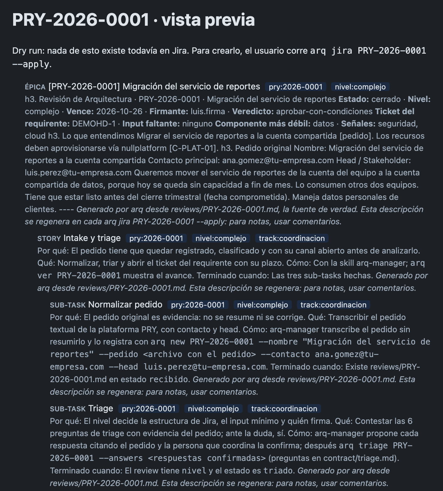

### Qué pasa al aplicar

Esto **no se corrió** (escribe en Jira): es lo que documenta el CLI y las skills.

- Crea la épica, las historias y las sub-tasks, y el ticket del requirente **a su nombre**, buscándolo en Jira por email:
  en el canal `jsm` como pedido de Service Management con el head de participante; en `software` como issue del help
  desk con el contacto de reporter y el head de watcher.
- Imprime una línea como `épica: DEMO-1 (creados N, existentes M; …)` y `jsm: DEMOHD-1 (creado; …)`; ahí se verifica.
- Cada escritura queda en `.arq/jira-writes.jsonl`.

**Qué pasa si algo sale mal**

| Situación | Resultado |
|---|---|
| Faltan `JIRA_BASE_URL`, `JIRA_EMAIL` o `JIRA_API_TOKEN` | `error: faltan variables de entorno: …`; no se escribe nada |
| Falta `canal_requirente` o sus claves en `config.json` | Con `--apply`, el CLI dice qué falta antes de escribir |
| Jira rechaza algo a mitad de camino | Lo creado se conserva; **el mismo comando retoma sin duplicar** |
| No se encuentra al contacto en Jira | Hay que darlo de alta y repetir el mismo comando |
| Jira rechaza el reporter | A la cuenta le falta el permiso «Modify reporter»; después, repetir el comando |
| Alguien renombra un issue en Jira | Es seguro: `arq` lo reconoce por su ID estable, no por el texto |

## 3. Cómo viene un pedido

**Skill:** `arq-manager` · **Escribe en Jira:** no (solo lectura; necesita credenciales).

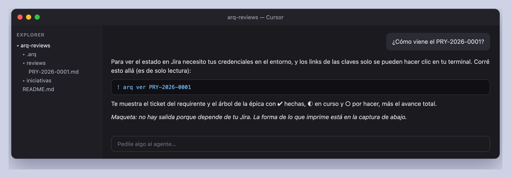

*Maqueta completa.*

`arq ver PRY-2026-0001` muestra el ticket del requirente y el árbol de la épica con el estado, el responsable y el avance
de cada issue (✔ hecho, ◐ en curso, ○ por hacer). En una terminal que lo soporte, las claves son links clickeables
(OSC 8); `--sin-links` los apaga. Por eso el agente te da el comando para que lo corras en tu terminal.

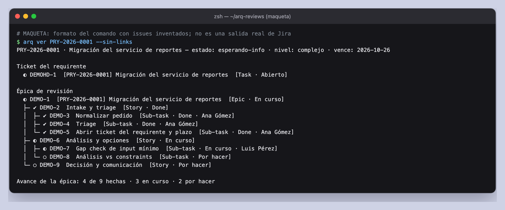

*Maqueta: **no es una salida real de Jira**. Es el formato que imprime el comando, generado con el renderizador del
repo sobre issues inventados.*

Si el pedido todavía no tiene épica, `arq ver` lo dice y te manda a `arq jira … --apply`.

## 4. Gap check y pedido de información

**Skills:** `arq-architect` (revisa) y `arq-manager` (publica) · **Escribe en Jira:** solo al publicar, con `--apply`.

`arq-architect` contrasta el pedido y su documentación contra el input mínimo del nivel
(`contract/minimum-input.md`). El test: cada afirmación tiene que apuntar a un número, componente, diagrama o métrica;
si no, es prosa y cuenta como faltante. También verifica que la documentación esté vigente comparándola con el código.

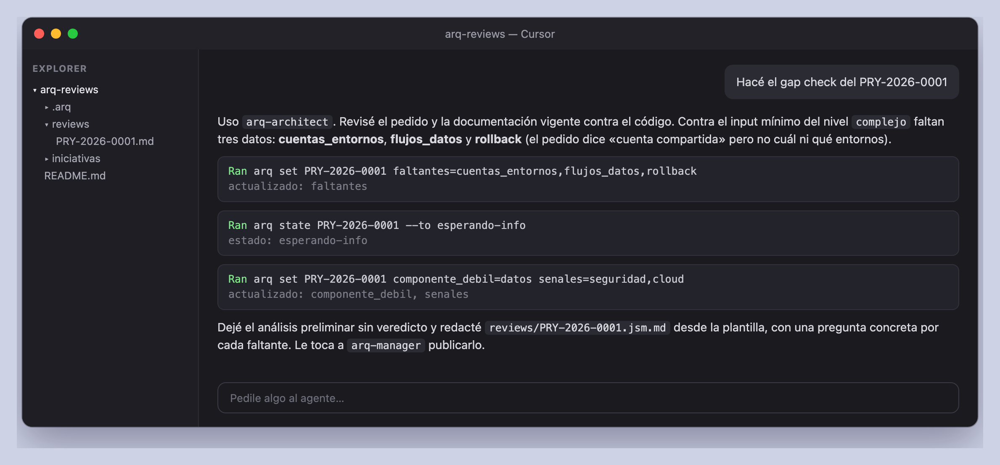

*Maqueta; los bloques «Ran» son salida real.*

### Qué corre el agente

| # | Comando | Para qué | ¿Escribe en Jira? |
|---|---|---|---|
| 1 | `arq set PRY faltantes=cuentas_entornos,flujos_datos,rollback` | Anotar los IDs que faltan (solo los del nivel) | No |
| 2 | `arq state PRY --to esperando-info` | Pasar el review a espera | No |
| 3 | `arq set PRY componente_debil=datos senales=seguridad,cloud` | Dejar el análisis preliminar, sin veredicto | No |
| 4 | `arq timebox PRY` | Fijar el plazo la primera vez, consultarlo después | No |
| 5 | `arq jsm PRY --file reviews/PRY.jsm.md --public --template jsm-pedido-info.md` | Dry run: el mensaje exacto | No |
| 6 | `arq jsm … --apply` | Publicarlo. **Lo corrés vos** | Sí |

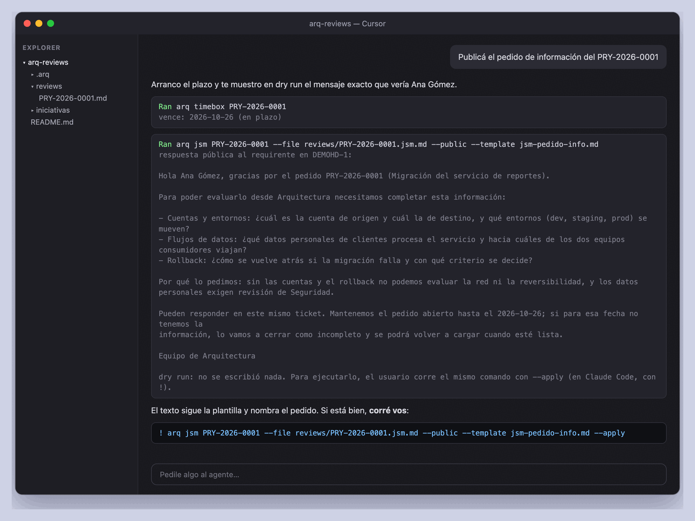

*Los bloques «Ran» son salida real, sobre un review de prueba al que se le cargó a mano el ticket (`DEMOHD-1`), porque
crearlo escribe en Jira.*

Una pregunta **concreta para este pedido** por cada faltante (nunca genérica) y por qué se pide. Si la fecha comprometida
del pedido es anterior al vencimiento, el agente ordena las preguntas para que primero estén las que la bloquean.

**Qué te protege**

| Situación | Resultado |
|---|---|
| El texto no sigue la plantilla `jsm-pedido-info.md` | `error: el texto no sigue la plantilla …: redactarlo desde ella` |
| El texto no menciona su `PRY` | El CLI lo rechaza: ¿es la respuesta de otro pedido? |
| El review no está en `esperando-info` | El CLI lo rechaza: esa plantilla se publica en ese estado |
| Es el mismo mensaje que ya se publicó | No se reenvía |
| Faltantes con un ID que no es del nivel | `arq set` lo rechaza y lista los válidos |

## 5. Análisis y veredicto

**Skill:** `arq-architect` · **Escribe en Jira:** no (deja todo en `reviews/PRY-AAAA-NNNN.md`).

Con el input completo, `arq-architect` analiza. El método, tal como lo fija la skill:

1. Reformular el pedido en un párrafo.
2. Descomponer en componentes: `computo, datos, identidad, red, aprovisionamiento, operacion, costo`.
3. Evaluar cada uno contra las constraints: `ok | débil | bloqueante`.
4. Si el original es viable, **la Opción 0 es el original y las dos opciones son solo para el componente más débil**; si no
   es viable, dos alternativas completas.
5. Cada opción con costo en orden de magnitud, esfuerzo, riesgo, reversibilidad y constraints que toca.
6. Recomendación con condiciones verificables; señales para Cloud, Seguridad y FinOps **sin veredicto**.
7. Cada afirmación lleva `[pedido]`, `[C-XXX-NN]`, `[supuesto]` o `[verificar]`: ningún número sin etiqueta.

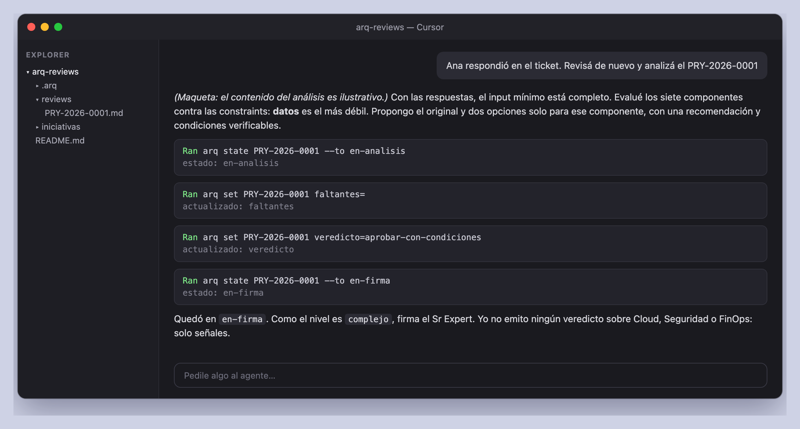

*Maqueta; los bloques «Ran» son salida real. El contenido del análisis es ilustrativo: depende del pedido.*

| Situación | Veredicto |
|---|---|
| Bloqueante sin solución | `rechazar`, con opciones que cumplen |
| Bloqueante resoluble o condicionantes | `aprobar-con-condiciones` |
| Todo ok | `aprobar`, con recomendaciones |

**Qué te protege**

| Situación | Resultado |
|---|---|
| Veredicto con input faltante | `arq set` lo rechaza: primero hay que pedir la información |
| Pasar a firma sin veredicto, o con faltantes | `arq state` lo rechaza |

## 6. Firma, devolución y cierre

**Skill:** `arq-manager` · **Escribe en Jira:** solo con `--apply`.

Firma una persona según el nivel: `simple`, alguien del track técnico; `complejo`, el Sr Expert. Es política interna: no
se escribe en los tickets.

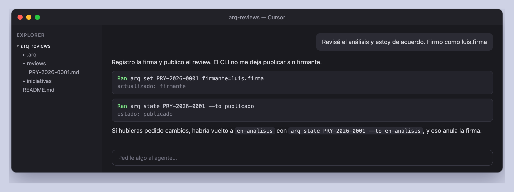

*Los bloques «Ran» son salida real.*

- Si el firmante pide cambios: `arq state PRY --to en-analisis`. Eso **anula la firma**, y el veredicto y los faltantes
  solo se pueden cambiar ahí; al volver a `en-firma` hay que firmar de nuevo.
- Con el review `publicado`, la devolución sale con `arq jsm … --public --template jsm-devolucion.md` (dry run y
  después `--apply`, que corrés vos).

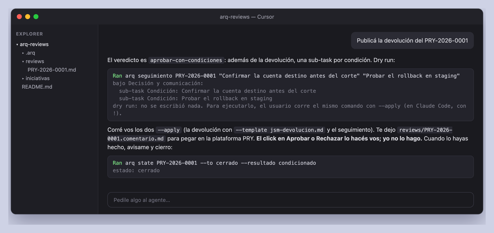

*El bloque «Ran» del seguimiento es salida real.*

Si el veredicto es `aprobar-con-condiciones`, una sub-task por condición con `arq seguimiento PRY "condición 1" …`. Después
el agente te da `reviews/PRY.comentario.md` para pegar en la plataforma, y **el click en Aprobar o Rechazar lo hacés
vos**. Si aplica escalar a RFC, sugiere la skill `product-brain` y el link entre épicas con `arq link`. Cuando confirmás
el click: `arq state PRY --to cerrado --resultado <resultado>`.

**Qué te protege**

| Situación | Resultado |
|---|---|
| Publicar sin firmante | `error: no se puede publicar sin firmante: …` |
| Firmar fuera de `en-firma` | `arq set` lo rechaza: se firma sobre el veredicto propuesto |
| Cerrar con un resultado que no corresponde al veredicto | `aprobar` → `aprobado`, `aprobar-con-condiciones` → `condicionado`, `rechazar` → `rechazado`; otro, el CLI lo rechaza |
| `arq seguimiento` sin un veredicto `aprobar-con-condiciones` ya publicado | Se niega |

## 7. Plazo vencido

**Skill:** `arq-manager` · **Escribe en Jira:** solo al publicar el cierre, con `--apply`.

El requirente no respondió y el plazo pasó. `arq timebox` lo dice y te indica el paso siguiente:

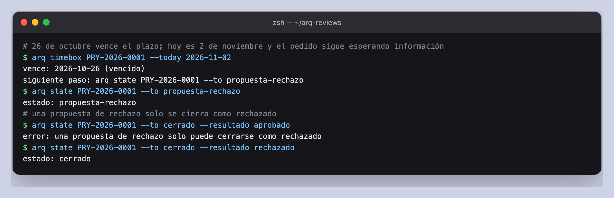

*Salida real; `--today` simula la fecha para la demostración.*

Después, el agente redacta `reviews/PRY.jsm.md` desde `jsm-cierre.md`, lo publica con `--template jsm-cierre.md` (dry run y
`--apply`) y **una persona rechaza en la plataforma** con el motivo y el link al JSM. Recién entonces se cierra el review.

## 8. Tuning con golden cases

**Skill:** `arq-architect` · **Escribe en Jira:** no.

Cada revisión real que sale mal se convierte en un *golden case* en `tests/golden/`: un `input.md` y un `expected.json` con
propiedades que el review tiene que cumplir (nivel, estado, qué debe pedir, qué constraints debe citar, componente débil,
señales y si no debe emitir veredicto), nunca texto exacto.

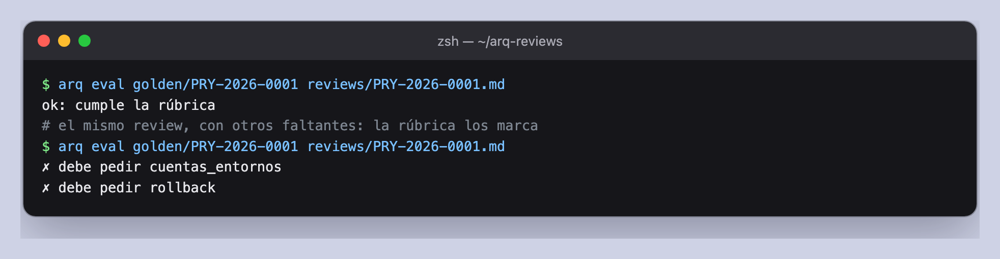

*Salida real, con un golden case de ejemplo (`PRY-2026-0001`), no uno de los del repo.*

Un golden se corrige solo si cambia la evidencia (triage real, documentación vigente), nunca para que pase la salida del
architect.

## 9. Las guardas del CLI

**Skill:** `arq` (CLI) · **Escribe en Jira:** no (todo esto se rechaza antes de escribir).

El agente puede equivocarse o ir demasiado rápido; el CLI está para no dejarlo. Todos estos errores son reales:

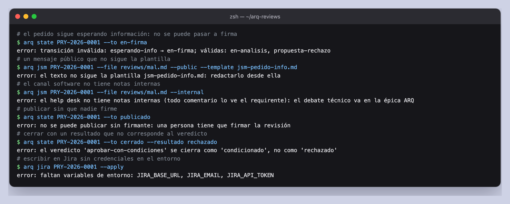

| Si… | Entonces |
|---|---|
| El agente quiere saltear un estado | La transición se rechaza y lista las válidas |
| El mensaje público no sigue la plantilla | No sale |
| Se pide una nota interna en el canal `software` | Se rechaza: todo comentario lo ve el requirente |
| Se publica sin firmante | Se rechaza |
| El cierre no corresponde al veredicto | Se rechaza |
| Faltan las credenciales | `--apply` no escribe nada |
